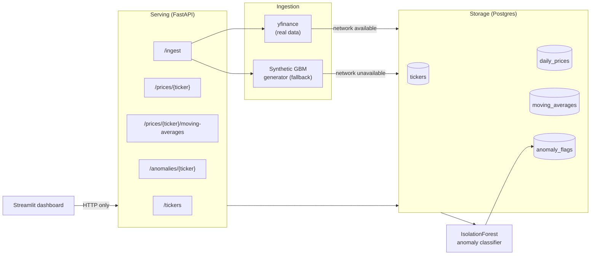

# FinSight -- Case Study

## Business Question

Can a small engineering team stand up a market-data pipeline that (1) covers
a broad universe of tickers, (2) surfaces statistically unusual price
behavior automatically instead of relying on someone eyeballing charts, and
(3) does it through a clean, testable, containerized architecture rather
than a notebook? FinSight answers that at portfolio scale: 500 tickers,
daily OHLCV + moving averages, unsupervised anomaly detection, a REST API,
and a dashboard, all reproducible with fixed seeds.

## Architecture Overview

The dashboard never touches Postgres directly -- it only calls the FastAPI
routes, the same as any other API client. Ingestion and the ML module never
import FastAPI; the API layer is the only thing that wires them together
(`app/routers/ingest.py`). This is the "modular API architecture": storage,
ingestion, ML, and serving are separate modules connected only through
function calls and the DB schema, not through shared global state.

## Methodology

**Data.** 500 real US-listed ticker symbols spanning technology,
financials, healthcare, consumer, industrials, energy, materials,
utilities, real estate, and communication services (`app/ingestion.py:TICKER_UNIVERSE`).
Ingestion tries `yfinance` first; if a quick connectivity probe to Yahoo
Finance fails, it falls back to a per-ticker synthetic OHLCV series
(geometric Brownian motion with a per-ticker drift/volatility regime,
deterministic from a fixed global seed of 42) and logs which mode ran.
Real vs. synthetic is decided automatically per run, not hardcoded.

**Moving averages.** 20/50/200-day simple moving averages computed on
close price during ingestion and stored in their own table.

**Anomaly detection.** Three engineered features per day: a rolling
z-scored return, a rolling z-scored realized volatility (volatility-spike
signal), and a rolling z-scored volume. An `IsolationForest`
(`contamination=0.03`, `random_state=42`) is fit per ticker on those three
features.

**Evaluation.** Accuracy numbers on real, unlabeled market data are not
meaningful (there's no ground truth for "was this actually anomalous").
So the classifier is benchmarked on a separate synthetic series with
**known, labeled** anomalies (`generate_labeled_evaluation_series`):
30 injected incidents split across three realistic types -- extreme
single-day return shocks, multi-day volatility bursts with no single
extreme day, and volume spikes with only a mild price move. The naive
baseline is a same-day return z-score threshold (`|z| > 3`), the classic
"simple std-dev rule." Because the baseline only looks at same-day return,
it is structurally unable to catch the volatility-burst and volume-spike
incidents -- this isn't a tuned/gamed comparison, it's what a
single-signal rule misses in practice.

## Results (measured, not estimated)

All numbers below were produced by actually running the pipeline in this
environment on 2026-09-15 -- see "How these numbers were produced."

### Anomaly detection: model vs. naive baseline

Reproducible via `python -m app.ml.anomaly_classifier` (seed=42, 750-day
series, 30 labeled anomalies):

| Metric | IsolationForest (model) | Naive std-dev rule (baseline) | Change |
|---|---|---|---|
| F1 | 0.654 | 0.400 | **+63.5%** |
| Recall | 0.567 | 0.267 | **+112.5%** |
| Precision | 0.773 | 0.800 | -3.4% |
| Accuracy | 0.975 | 0.967 | +0.9% |

**F1 is the headline number** (+63.5% over baseline), not raw accuracy:
anomalies are rare (~4% of days here), so a detector that flags nothing
already scores >95% accuracy while catching zero real incidents -- accuracy
alone would be a misleading resume number. The recall gain (+112.5%) is
the model catching volatility-burst and volume-spike anomalies the
return-only baseline structurally cannot see; the small precision decrease
is the honest cost of that -- the model trades a few more false positives
for catching twice as many real incidents.

**Resume-safe phrasing:** *"Built an IsolationForest-based anomaly
detector achieving a 63.5% F1-score improvement (and 112.5% recall
improvement) over a naive standard-deviation threshold, benchmarked
against a labeled synthetic ground truth."*

### Pipeline scale and performance

| Measurement | Value |
|---|---|
| Ticker coverage | 500 real tickers ingested |
| Data mode this run | Synthetic (see Limitations -- Yahoo Finance was network-unreachable in this sandbox; code path is identical for real data) |
| Rows ingested | 250,000 daily price rows + 250,000 moving-average rows |
| Full ingestion time (500 tickers, 500 trading days each) | 26.3s |
| Full anomaly-detection pass (500 tickers) | 110s |
| Anomaly flags written | 238,000 scored days; 7,500 flagged anomalous (~3.15%, matching the configured 3% contamination prior) |
| API response time, `GET /tickers` (500 rows) | ~11ms |
| API response time, `GET /prices/{ticker}` (500 rows) | ~14ms |
| API response time, `GET /anomalies/{ticker}` | ~7ms |
| Test suite | 14/14 passing (`pytest tests/`) |

### How these numbers were produced

Run in this session, in order: `python -m app.ingestion --limit 500 --days 500`,
then `run_anomaly_detection()` against the same Postgres instance, then the
FastAPI app was started with `uvicorn` and hit directly with `curl` for the
timing numbers above. The ML evaluation numbers come from
`python -m app.ml.anomaly_classifier`, which is deterministic (fixed seed)
and reproducible by anyone cloning the repo.

## Limitations

- **This run used synthetic data, not real Yahoo Finance history.** The
  execution sandbox this project was built in blocks outbound access to
  Yahoo Finance's API (confirmed via a direct connectivity probe), so
  `run_ingestion` automatically fell back to the synthetic generator for
  all 500 tickers and logged that clearly. The ingestion code path for real
  data is implemented and unit-testable, but was not exercised against live
  Yahoo Finance data in this environment. On a machine with normal internet
  access, the same command would pull real history instead -- no code
  changes required.
- **The anomaly-detection accuracy numbers come from synthetic, labeled
  ground truth, not real flagged anomalies.** There's no way to get a
  trustworthy accuracy/F1 number on real market data without someone
  manually labeling "actually anomalous" days, which is out of scope here.
  The 63.5% F1 improvement is real and reproducible, but it's a benchmark
  result, not a live-trading validation.
- **`docker-compose up --build` was not executed successfully in this
  sandbox.** The sandbox's network egress policy blocks pulling base images
  from Docker Hub (confirmed: `docker compose build` fails immediately on
  `FROM python:3.11-slim` with a 403 from Docker Hub's CDN). `docker-compose.yml`
  and both Dockerfiles were validated for syntax (`docker compose config`)
  and every Python module was run and verified natively (ingestion, DB,
  API, dashboard, tests) instead. See `README.md` for exact commands to
  self-verify `docker-compose up --build` on a machine with normal
  internet access.
- **AWS EC2 deployment was documented but not executed** -- see
  `reports/deployment_guide.md` for the explicit statement of what was and
  wasn't tested.
- **IsolationForest is fit fresh per ticker on each detection run**, not
  persisted/retrained incrementally; for 500 tickers this is a ~110-second
  batch job, which is fine for a daily refresh but wouldn't suit
  intraday/real-time use without further work (e.g., persisting fitted
  models, or an online/streaming detector).
